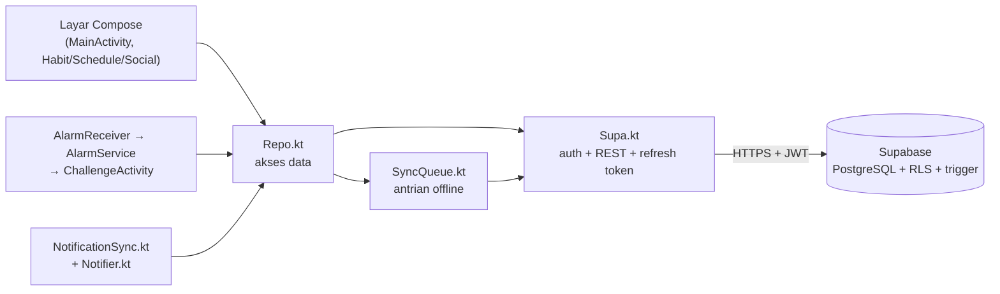
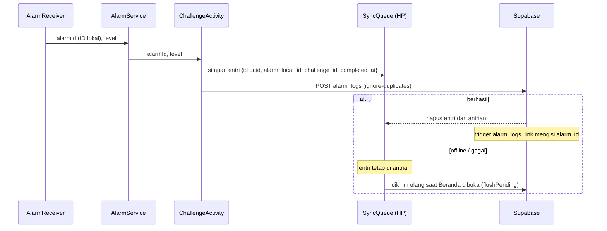

# Arsitektur Backend WakeUp

WakeUp memakai **Supabase sebagai backend** (PostgreSQL + Auth + REST/PostgREST). Tidak ada server sendiri;
logika backend terbagi dua: **di database** (trigger, fungsi, RLS) dan **di lapisan data aplikasi** (`Supa.kt`, `Repo.kt`, `SyncQueue.kt`, `NotificationSync.kt`).

## Tanggung jawab tiap komponen

| Komponen | Tugas |
|---|---|
| `Supa.kt` | Login/registrasi, simpan sesi, refresh token otomatis, logout (cabut token di server), cek username (`username_available`) |
| `Repo.kt` | Semua query: profil, alarm, habit, reminder, teman, grup, jadwal bersama, statistik bangun |
| `SyncQueue.kt` | Antrian lokal untuk data yang harus terkirim walau HP sedang offline |
| `NotificationSync.kt` | Memasang notifikasi habit/reminder dari data cloud + cache agar pulih setelah restart |
| Database | RLS (siapa boleh akses apa), trigger (profil otomatis, undangan jadwal, `updated_at`, tautan `alarm_logs`), fungsi RPC |

## Alur: alarm selesai → riwayat tersimpan

Karena `id` dibuat di HP, mengirim ulang entri yang sama tidak membuat data ganda.
Entri yang lebih dari 30 hari dibuang agar antrian tidak menumpuk.

## Sesi & keamanan

- Token akses dan refresh token disimpan di penyimpanan privat aplikasi; saat token kedaluwarsa (HTTP 401) aplikasi otomatis refresh sekali lalu mengulang request.
- Jika refresh token **ditolak server**, sesi dihapus dan pengguna diminta masuk lagi. Jika hanya **jaringan putus**, sesi dipertahankan.
- Logout mencabut token di server (`/auth/v1/logout`), bukan hanya menghapus data lokal.
- Seluruh akses data dibatasi RLS (lihat `docs/DATABASE.md`); kunci yang ada di aplikasi hanya *publishable key*.

## Notifikasi (habit & reminder)

`AlarmManager` kehilangan semua jadwal saat HP restart. Alarm utama sudah dipasang ulang oleh `BootReceiver`; untuk
habit dan reminder, `NotificationSync` menyimpan cache jadwal terakhir dan `BootReceiver` memasangnya lagi **tanpa internet**.
Saat Beranda dibuka, `NotificationSync.sync()` menyegarkan jadwal dari Supabase (termasuk dari perangkat lain) dan
membatalkan notifikasi yang itemnya sudah dihapus.

## Pendaftaran akun

1. Aplikasi memvalidasi format username (3-20 karakter: `a-z`, `0-9`, `.`, `_`).
2. Memanggil `username_available` agar pengguna mendapat pesan jelas jika username sudah dipakai.
3. Supabase Auth membuat akun, trigger `on_auth_user_created` membuat baris `profiles`.
   Sebagai pengaman terakhir, trigger memberi angka di belakang username bila terjadi tabrakan.

## Rencana pengembangan backend
- Notifikasi untuk jadwal grup dan undangan teman (Supabase Realtime atau push notification).
- Statistik bangun dihitung di database (fungsi RPC) agar tidak bergantung pada batas 1000 baris.
- Penyimpanan token memakai `EncryptedSharedPreferences`.
