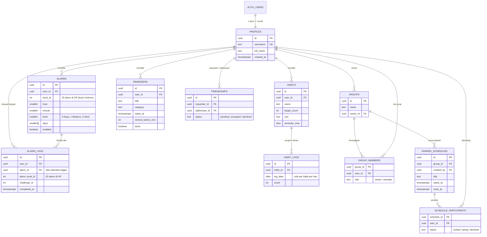

# Dokumentasi Database WakeUp

Database: **Supabase (PostgreSQL)**. Login/registrasi memakai **Supabase Auth** (`auth.users`).
Aplikasi Android mengakses data lewat REST API Supabase (PostgREST) dengan token pengguna, sehingga seluruh akses dikendalikan oleh **Row Level Security (RLS)**.

File SQL (jalankan berurutan di Supabase → SQL Editor):

| Urutan | File | Fungsi |
|---|---|---|
| 1 | `supabase-schema.sql` | Membuat tabel, trigger, fungsi bantu, RLS, index |
| 2 | `supabase-migration.sql` | Perbaikan v2: sinkron alarm aman, `updated_at`, trigger undangan jadwal, pengetatan policy |
| 3 | `supabase-backend.sql` | v3: `alarm_logs` terhubung ke `alarms`, fungsi `username_available` |
| 4 | `supabase-seed.sql` | (Opsional) data demo untuk presentasi |

## ERD

## Hubungan fitur ↔ tabel

| Fitur aplikasi | Tabel |
|---|---|
| Registrasi / login / profil | `auth.users`, `profiles` |
| Alarm challenge + cadangan cloud | `alarms` |
| Streak & statistik bangun | `alarm_logs` (dihitung dari sini; penyimpanan lokal hanya cadangan offline) |
| Habit tracker | `habits`, `habit_logs` |
| Reminder & jadwal pribadi | `reminders` |
| Teman (cari, request, terima/tolak) | `friendships` |
| Grup | `groups`, `group_members` |
| Jadwal bersama (ikut / tidak bisa) | `shared_schedules`, `schedule_participants` |
| Deteksi jadwal bentrok | dihitung di aplikasi dari `reminders` + `shared_schedules` |

## Keamanan (RLS)

RLS aktif di **semua** tabel.

- **Data pribadi** (`alarms`, `alarm_logs`, `habits`, `habit_logs`, `reminders`): hanya pemilik (`user_id = auth.uid()`).
- **`profiles`**: semua pengguna login boleh membaca (dibutuhkan untuk mencari teman); hanya pemilik yang boleh mengubah.
- **`friendships`**: kedua pihak bisa melihat; hanya pengirim yang membuat request (status `pending`); hanya penerima yang menjawab, dan hanya kolom `status` yang boleh berubah (dijaga trigger `friendships_guard`).
- **`groups` / `group_members`**: hanya anggota yang melihat; hanya owner yang menambah anggota, dan hanya teman berstatus `accepted`.
- **`shared_schedules` / `schedule_participants`**: hanya anggota grup yang melihat; peserta hanya mengubah status dirinya sendiri.
- Fungsi bantu `is_group_member`, `is_group_owner`, `can_see_schedule`, `are_friends` memakai `security definer` agar policy tidak saling memanggil berulang (rekursi).

> Kunci `sb_publishable_...` (anon key) di `Config.kt` memang dirancang untuk berada di aplikasi klien, aman selama RLS aktif.
> **Jangan pernah** menaruh kunci `service_role` / `secret` di repo.

## Trigger otomatis

| Trigger | Fungsi |
|---|---|
| `on_auth_user_created` | Membuat baris `profiles` saat user registrasi (username dinormalisasi, otomatis diberi angka jika sudah dipakai) |
| `on_group_created` | Pembuat grup otomatis jadi anggota dengan role `owner` |
| `on_schedule_created` | Semua anggota grup otomatis diundang ke jadwal (pembuat langsung `going`) |
| `on_member_added` / `on_member_removed` | Anggota baru diundang ke jadwal mendatang; anggota yang keluar dihapus dari jadwal mendatang |
| `friendships_guard` | Mencegah penerima mengubah kolom selain `status` |
| `*_set_updated_at` | Mengisi `updated_at` otomatis |
| `alarm_logs_link` | Mengisi `alarm_logs.alarm_id` dari `alarm_local_id` yang dikirim aplikasi |

## Fungsi RPC

| Fungsi | Fungsi |
|---|---|
| `username_available(uname)` | Mengembalikan `true/false`; dipanggil saat registrasi (bisa diakses sebelum login) |

## Catatan desain

- **Alarm: lokal sebagai sumber utama, cloud sebagai cadangan.** Alarm harus tetap berbunyi tanpa internet, jadi jadwal di-handle `AlarmManager` di HP. Sinkron memakai upsert berdasarkan `(user_id, local_id)`.
- **Streak** dihitung dari tanggal unik di `alarm_logs` (zona waktu perangkat), sehingga tidak hilang saat pindah HP / install ulang.
- **Pencarian teman** memakai `username`; request yang pernah ditolak dihapus otomatis saat dikirim ulang.
